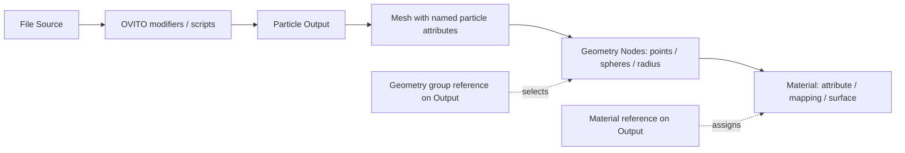

bleMD appearance workflow — proposed design for Blender 4.2.2

The bleMD graph defines simulation data and chooses how its output is displayed.
Geometry Nodes builds the visible geometry. Shader Nodes maps properties to
appearance and controls the surface. Named attributes connect these stages;
references to real Blender node groups and materials connect their interfaces.
This document remains the broader design proposal. The implemented typed
analysis, color-field, and named-attribute flow is described in
[Particle fields](../particle-fields.md); the property browser, geometry-group
selector, and navigation controls below remain planned.

**The user flow starts at Particle Output.** After Update, the output exposes a
Properties list discovered from the final OVITO data: property name, numeric
shape, semantic type, and whether it is transferred to Blender. It also exposes
Geometry and Material selectors, plus Edit Geometry, Edit Material, and Inspect
Data buttons. Existing Radius becomes an exposed input of the selected geometry
modifier. It remains accessible from the output without changing editors.

Selecting a bleMD material shows compact controls on the output/sidebar:
Color Mode, Property, Component, Range, and Colormap. These controls edit the
material's own mapping nodes. They do not create a second copy of material
settings on the output node. An arbitrary Blender material is also valid: it
shows its material selector and Edit Material, without invented color controls.
The user can add a bleMD mapping group to that material explicitly.

Example: Update a pipeline containing centrosymmetry analysis; choose
Centrosymmetry in Color By; choose Viridis; set the range to 0–10. Change radius
without rerunning analysis. Open the material to adjust roughness or connect the
same mapped color to emission. Open Geometry Nodes to replace points with sphere
instances. Each editor retains the same output object and its attributes.

**The attribute contract is shared by all three editors.** Retain original
property names where Blender can represent them, and store an explicit
original-name-to-Blender-name mapping if a name conflicts with a built-in or
reserved attribute. Never rely on Blender silently appending a suffix. Reserve
an internal `blemd_` namespace for derived display attributes; preserve colliding
source properties through the mapping. The property picker uses the human-facing
original name and the correct stored attribute name internally.

Import scalar measurements as floats, discrete integer properties as integers,
and vectors as vectors. Treat OVITO Color explicitly as RGB and transfer it as
a Blender color attribute with alpha 1. Preserve type metadata (category IDs,
names, colors) separately from particle arrays. Do not infer that every integer
is categorical: coordination number is a quantity, while Particle Type carries
a category table. Large particle identifiers keep the current explicit
32-bit limitation until a lossless representation is implemented.

Initially retain the default of importing all supported numeric properties.
Explicitly selected transfer lists must include properties required by managed
materials and geometry inputs; missing requirements produce a clear diagnostic.
A property selection cannot silently render as zero because it was omitted from
the transfer list. Arbitrary user graphs may read dynamically named attributes,
so complete dependency inference is not promised; importing all is the reliable
default. Float statistics exclude NaN/Inf and report when no finite values exist.

Geometry Nodes reads imported values with Named Attribute. A value computed in
Geometry Nodes becomes available to shaders through Store Named Attribute.
The generated geometry group preserves particle attributes through its supported
representations. Sphere instancing needs an explicit, tested policy for carrying
attributes on instances and, when requested, through realization. Do not insert
Realize Instances unconditionally: it can multiply memory use substantially.
Geometry-created names can initially be entered with a declared type; the
Spreadsheet is the inspection route. Automatic discovery of every attribute in
arbitrary evaluated point-cloud/instance graphs is not a first-release promise.

**Color has four explicit modes.**

| Mode | Input | Mapping |
| --- | --- | --- |
| Constant | A chosen color | Pass directly to the surface |
| Scalar | A scalar, vector component, or vector magnitude | Normalize, clamp, and apply a ramp |
| Categories | Type IDs and their metadata | Discrete ID-to-color lookup; never interpolate between categories |
| RGB Property | An existing RGB property, usually OVITO Color | Pass through without applying another colormap |

Category mappings are keyed by IDs, not by the observed order or count of types
in the current frame. Missing categories do not shift other colors. Unknown IDs
use an explicit fallback. Large/sparse category IDs should be remapped to compact
palette indices before shader lookup, avoiding shader floating-point precision
loss for raw integer identifiers.

The default color mode is Constant. The UI offers Use OVITO Color when Color is
available and Use Type Colors when category metadata is present. Choosing either
is explicit, so adding a modifier that emits Color cannot unexpectedly replace a
user's scalar mapping. An OVITO color-coding modifier remains useful when color
is intentionally computed upstream. This is distinct from choosing a property
and colormap in Blender; the two paths must not apply normalization twice.

Color-space conversion belongs at the OVITO-to-Blender boundary. Verify OVITO's
RGB convention and Blender's scene-linear storage with known color swatches
before claiming visual parity. Display transforms, lighting, and material
response can differ even when the underlying RGB values are transferred
correctly. Keep the raw source values available for inspection.

**Build on the existing shader.** Its current path is Attribute → Subtract Min →
Divide by Range → Color Ramp → Principled BSDF. Package this behavior in an
ordinary, editable ShaderNodeTree group named bleMD Color Mapping, with Color
and Normalized Value outputs. It can feed Base Color, Emission Color, or other
shader nodes. Roughness, metallic, transmission, emission strength, and opacity
remain normal material/shader controls. Opacity is not inferred from a vector
component or from a particle's Selection property.

Each material receives its own mapping group by default. A shared group would
otherwise make one material's property-name or ramp edits affect unrelated
materials. Property names live on the internal Attribute nodes; do not depend
on exposing an attribute-name string socket in a shader-group interface.
Numeric range parameters are real group input sockets, and the ramp editor
edits the real internal Color Ramp. Colormap presets write ramp stops only when
chosen; manually editing stops changes the preset display to Custom. Direct
Shader Editor edits are reflected in the compact controls without a separate
synchronization copy.

Mapping nodes and geometry interface sockets need stable identifiers and a
version marker. Names that the user can rename are not identifiers. If the
managed mapping is removed, disconnected, or replaced, show Custom Material
and offer an explicit Add Mapping action. A later pipeline update must not
reconstruct a user's material or reconnect a customized shader automatically.

**Ranges are stable unless the user chooses otherwise.** Default to a fixed,
editable range. Fit Current Frame calculates a range once from the cached
imported values and writes the bounds to the material. Scan Trajectory Range is
a separate, cancellable operation; it must describe the frame interval and
pipeline stage used. Defer that scan to a later release. Automatic per-frame
range is optional and clearly labeled because it can change the meaning of a
color during animation. Equal bounds map finite values to the ramp midpoint;
missing/invalid values use an explicit fallback and diagnostic.

Range statistics initially describe the imported OVITO output, before downstream
Geometry Nodes filtering. The UI labels that scope. A range over final generated
geometry or a Geometry Nodes-derived attribute requires a separate evaluated
statistics path; do not silently report upstream statistics as that result.

**Blender datablocks own the settings.**

| Owner | Authoritative settings |
| --- | --- |
| bleMD source/modifier nodes | File, OVITO analysis, playback, property transfer |
| Output object and geometry modifier | Geometry group, exposed radius/material inputs |
| Material and its mapping group | Property, component, color mode, range, palette/ramp |
| Output property catalog | Cached schema, category metadata, frame and statistics provenance |

The output displays references and proxies to these owners. Reading or editing
controls always resolves the explicit output object and material, never an
unrelated active object. Shared materials intentionally share their mappings.
Show their user count and provide Make Unique, which copies the material and
its managed mapping group. Shared geometry groups share topology, while modifier
input values remain per object. Persist state in .blend datablocks; runtime
OVITO objects remain transient.

The generated geometry group exposes Geometry, Radius, and Material inputs.
Once created, output controls set modifier input values by interface identifier,
instead of writing into nodes named Mesh to Points or Set Material. Users can
choose a custom group; map its inputs explicitly or use the native modifier UI.
If a controlled input becomes driven by a field/link, the compact UI indicates
that ownership rather than overwriting it. Updating simulation data preserves
modifier order, geometry graphs, materials, shader links, and user settings.

**Navigation is part of the feature.** Edit Geometry opens the output object's
actual geometry modifier. Edit Material opens and pins the assigned material.
Each destination exposes Back to bleMD for the originating tree/output, and an
Open Beside option supports comparison without replacing the current editor.
Inspect Data selects the same output for Spreadsheet inspection. Do not change
an already pinned, unrelated editor behind the user's back.

The three node systems remain separate executable graphs. Geometry groups and
materials are referenced Blender datablocks, not raw geometry or shader sockets
wired directly into the custom OVITO tree. If the output becomes crowded later,
Geometry and Material reference nodes can expose those same references without
introducing a second settings model. Start with selectors on Particle Output.

**Changes trigger the smallest required update.**

| Edit | Work required |
| --- | --- |
| OVITO source, modifier, script, or simulation frame | Explicit pipeline Update in the current version |
| Property transfer list | Update to fetch the requested data |
| Scalar property already imported, range, palette, surface settings | Shader update only |
| Radius, geometry graph, material assignment | Blender geometry/shader evaluation only |
| Request a property not yet imported | Mark that data update is required; retain the last valid display |

**Migration and implementation order.** First introduce the property catalog,
explicit material ownership, stable geometry interface inputs, and navigation.
Then add the managed shader mapping group with scalar and RGB modes, real ramp
controls, fixed ranges, and Fit Current Frame. Add category metadata/palettes,
vector component choices, and geometry-generated property support next. Trajectory
range scans and arbitrary additional geometry representations follow separately.

Keep existing bleMD materials usable as-is. Offer an explicit migration for a
recognized legacy Attribute/Math/Color Ramp chain, preserving its selected
attribute, actual ramp stops, normalization values, BSDF settings, and external
links. Leave unrecognized or heavily edited materials in Custom mode. Changes
to scientific data must never silently discard artistic shader edits.

Acceptance checks should render a small known dataset through both the existing
and new mapping path, then verify scalar endpoints/midpoint, unchanged colors
across frames with fixed bounds, RGB passthrough, category stability, vector
components, and missing/invalid-value handling. Also cover attribute retention
through points and supported sphere instancing, material sharing/Make Unique,
manual shader and geometry edits surviving Update, explicit editor context,
undo, and save/reopen. Instrument the OVITO evaluation path to confirm that
changing a colormap or radius does not rerun analysis.

References: [Blender 4.2 shader Attribute node](https://docs.blender.org/manual/en/4.2/render/shader_nodes/input/attribute.html),
[Store Named Attribute](https://docs.blender.org/manual/en/4.2/modeling/geometry_nodes/attribute/store_named_attribute.html),
and [OVITO particle properties and type metadata](https://www.ovito.org/docs/current/reference/pipelines/data_objects/particles.html).
