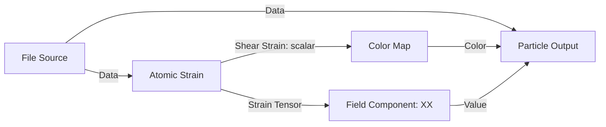

# Particle fields in the bleMD editor

Data sockets carry a complete OVITO dataset. Field sockets carry one measurement
per particle, together with the originating dataset and particle IDs. Analysis
can branch from the data stream instead of sitting between every data operation.

## File Source fields and the default graph

**New Pipeline** creates File Source, Color Map, and Particle Output. Data goes
straight to Particle Output, while Atom ID goes through Color Map into its Color
input. No OVITO Script node is inserted. Scripts remain available from Add.

With Automatic Updates enabled, choosing a file reads its first simulation frame and exposes numeric particle
properties on File Source. **Atom ID** corresponds to OVITO's `Particle Identifier`
and **Atom Type** to `Particle Type`. Position, velocity, custom scalar properties,
colors, tensors, and quaternions use their corresponding field socket types.
Nonstandard component counts are exposed as individual scalar component sockets.
These fields describe the imported data; fields created by downstream analyses
remain outputs of those analysis nodes.

Use **Refresh Fields** to reread the schema after replacing a file on disk. Update
also refreshes the schema. Existing connections to unchanged fields are retained.
If a connected field disappears or changes type, its old socket stays visible
as unavailable and Update reports the problem. Reconnect to a valid field to
resolve it. Saved field sockets and links survive reopening a `.blend`. Automatic
updates resume on reopening; disable them before saving to defer file I/O.

The starter Color Map uses **First-frame range**: minimum and maximum come from
the connected field at simulation frame 0. The same range applies to later frames.
Uniform fields use the midpoint color. Choose **Manual range** to enter fixed
limits. Other/new Color Map nodes retain manual range by default, preserving
existing graphs. Files without atom IDs need a different scalar connected to the
starter map; bleMD does not invent identifiers.

## CPK element coloring

Add **Particle Fields → CPK Color**, then connect:

**File Source / Atom Type → CPK Color / Element → Particle Output / Color**

Keep the Source Data connection to Particle Output. The node uses the
[Jmol CPK palette](https://jmol.sourceforge.net/jscolors/): hydrogen is white,
carbon gray, nitrogen blue, oxygen red, and sulfur yellow. Published sRGB colors
are converted to Blender's linear RGB before export. This works with the
existing Solid color attribute, default material, color utilities, and named
shader fields; custom materials can read `bleMD Color` with an Attribute node.

**Atom types** reads chemical symbols such as `C`, `O`, and `Fe` from the
connected property's OVITO type names. Numeric type IDs alone do not identify
chemical elements. For a LAMMPS file with numeric types, enter **Map** as
`1=C, 2=O, 3=Fe`. Entries override type names and may be separated by commas,
semicolons, or newlines. Symbols are case-sensitive; `D` and `T` use hydrogen's
color. Use Read Particle Property on a downstream Data branch if a modifier
changes type names or assignments.

Choose **Atomic numbers** for an explicit scalar atomic-number field (H=1,
C=6, N=7, O=8). This mode also accepts calculated integer fields. Type-name
metadata is retained by direct source/property fields and reroutes; calculated
fields in Atom types mode require explicit mappings.

**Unmapped** sets the fallback color (magenta by default) for unknown names,
unmapped IDs, or elements outside the published H–Mt (1–109) color table.
The remaining recognized elements Ds–Og also use this fallback. Fractional or
non-finite inputs and malformed/duplicate mappings report an error and preserve
the last mesh. Edits follow Automatic Updates, and colors retain particle-ID
alignment through reordered branches and trajectory playback. The node does
not change atomic radii or the File Source's type definitions.

## Arithmetic and utility nodes

Open **Add → Utilities** (Shift+A) in the bleMD editor:

| Node | Use |
| --- | --- |
| Math | All 41 Blender 4.2 scalar operations: Add, Multiply, Power, comparisons, trigonometry, and more; optional 0–1 result clamp |
| Vector Math | All 27 vector operations, including Scale, Normalize, Dot Product, Cross Product, and Length |
| Map Range | Scalar remapping with Linear, Stepped Linear, Smooth Step, or Smoother Step interpolation |
| Clamp | Limit a scalar to Min/Max or automatically sorted Range bounds |
| Mix | Blend two scalars, vectors, or RGB colors using a scalar factor |
| Value / Vector / RGB | Reusable constants broadcast to every particle |
| Separate / Combine XYZ | Split or assemble vector components |
| Separate / Combine Color (RGB) | Split or assemble linear RGB channels |

For example, connect **File Source / c_energy → Math / Value**, select
**Multiply**, set the second input to **2**, and connect the result to
**Particle Output / Radius**. The same result can branch into Color Map or a
named shader field. Data still connects directly from File Source to Output.
Unconnected inputs expose editable defaults; linked inputs use particle fields.
Operation selection shows the relevant inputs and outputs. If changing Vector
Math or Mix changes the output type, reconnect the appropriate output.

Utilities combine fields from OVITO analyses and source properties by particle
ID, including reordered branches. They require the same File Source and the
particles needed by the first field input's dataset. Constant-only branches
broadcast on the consuming dataset. Separate/Combine nodes make conversions
between scalar components, vectors, and RGB explicit; there are no implicit
type conversions. Tensor components use **Field Component** first.

**Add → Layout** contains Blender's native **Frame** and **Reroute** nodes.
Reroutes work with both Data and fields; endpoint types are checked even though
Blender displays generic reroute sockets in custom trees. Circular connections
report an error and preserve the previous particle mesh.

Blender 4.2 does not allow its native Math/shader/geometry node types inside a
custom tree. The bleMD equivalents evaluate particle arrays and use Blender's
operation names and mathematical behavior. Math, Vector Math, Map Range, and
Clamp are tested against Blender's actual Geometry Nodes evaluator. Vector
Modulo uses zero for a zero divisor, matching scalar Math's safe behavior;
Blender's native vector version produces NaN in that case. Other non-finite
results report an error. Color controls use RGB without alpha; Mix supports
linear blending, and Map Range currently supports scalars.

Calculations update with the existing Automatic Updates option. Field edits
reuse OVITO pipelines, results are shared between consumers during an update,
and temporary arrays are released afterward. Utilities run at saved simulation
frames; their floating-point results interpolate during stretched playback.
To calculate after interpolation or per shading point, export a named field and
use native Math or other nodes in Geometry Nodes or the Shader Editor.

## Analysis example

For example:



## Try Atomic Strain

A ready-to-open example can be generated after `make install`:

```bash
/opt/blender-4.2.2-linux-x64/blender --background --factory-startup --python scripts/create_field_demo.py
make run BLEND=examples/atomic-strain.blend
```

To build the same flow yourself:

1. Create a bleMD tree and choose a trajectory on File Source. Connect its Data
   output directly to Particle Output's Data input.
2. Add **Analysis > Atomic strain** and connect the same source to its Data input.
   Set cutoff and reference options as appropriate for your simulation.
3. Add **Particle Fields > Color Map**. Connect **Shear Strain → Value**, then
   **Color → Particle Output / Color**. Set the fixed range and endpoint colors.
4. The graph updates automatically. With no material assigned, bleMD creates a shader reading
   `bleMD Color`. An assigned material is preserved; use an Attribute shader node
   with that name to incorporate the colors into your shader.

`tests/fixtures/strain.dump` contains 27 atoms with a known affine deformation
between frames 0 and 1. Frame 0 is the default reference. Use Blender frame 1,
cutoff 3 (the default), and Color Map range 0–0.2 for this fixture.

Atomic Strain exposes shear strain, volumetric strain, strain tensor, deformation
gradient, stretch tensor, rotation quaternion, nonaffine squared displacement,
and invalid-particle Selection. Linking an optional result automatically enables
its computation, taking precedence over its output checkbox or configuration
script. Unconnected optional results keep their configured OVITO behavior.
The measurements follow [OVITO's Atomic Strain definitions](https://www.ovito.org/manual/reference/pipelines/modifiers/atomic_strain.html).

## Socket types and processors

| Socket | Meaning |
| --- | --- |
| Data (cyan) | Full OVITO dataset, including particles and other objects |
| Scalar (gray) | One numeric value per particle, including integer labels/selections |
| Vector (blue) | Three components per particle |
| Tensor / Quaternion (purple) | Four, six, or nine components per particle |
| Color (yellow) | Three linear RGB components per particle |

**Read Particle Property** extracts an arbitrary property from a Data connection.
Choose its actual type; incompatible shapes cause an Update error. Changing its
type removes old output links so that incompatible consumers must be reconnected.

**Field Component** takes exactly one vector or tensor/quaternion input and
returns one scalar component or the Euclidean norm of the stored components.
Indices are zero-based. Symmetric tensor order is XX, YY, ZZ, XY, XZ, YZ;
quaternion order is X, Y, Z, W. The component norm is not a physical tensor
invariant or rotation angle.

**Color Map** maps a scalar through a manual or first-frame-derived range,
clamping at the endpoints. **Colorbar** offers all 111 existing bleMD presets
(including reversed variants), plus the original **Two colors** option. The
first-frame range stays stable during playback. Palette edits update Solid and
Material Preview together when using the default field-color material.

In the **Shader Editor**, use **Add → bleMD Color Map**. This creates a native
shader group with **Value**, **Minimum**, and **Maximum** inputs and **Color**
output. Select the group and choose **N → bleMD → Colorbar** to change its preset.
The particle and shader versions use the same stops and interpolation. Like the
legacy Blender ramps, presets use at most 32 stops. Shader-only changes affect
Material Preview and renders; Solid displays the particle Color input.

**Particle Output** accepts Data and optional fields:

| Input | Mesh attribute | Blender type |
| --- | --- | --- |
| Color | `bleMD Color` | Color (RGBA, alpha 1) |
| Radius | `bleMD Radius` | Float |
| Value | `bleMD Value` | Float or integer |
| Vector | `bleMD Vector` | Vector |
| Added shader field | Your chosen name | Scalar, vector, or color |

With **Radius** unconnected, edit its value directly on the input socket; this
default applies to every particle. The same inline controls are available for
unconnected scalar, vector, and color shader inputs. Linking overrides the
saved default; disconnecting restores it. Added shader fields export their
constant defaults even without a connection.
Connecting a scalar field uses that value multiplied by **Radius Scale**, in
Blender distance units. Values must be finite and nonnegative; zero hides an
atom's sphere. The same radii feed viewport spheres and render points. Use **Utilities → Math** to calculate a radius, wire an existing analysis field,
or use OVITO **Compute Property** with **Read Particle Property**.

With **Color** unconnected, edit the color swatch on the socket. Editing the
swatch selects **Uniform** automatically. You can also choose
**From data / fallback** to use native OVITO Color when present and the specified
color otherwise. A connected Color field takes precedence. Existing custom
materials retain their own shader graphs.

Use **+ Value**, **+ Vector**, or **+ Color** on Particle Output to add as many
shader inputs as needed. Give each a unique attribute name and connect a source
or analysis field. For example, export Shear Strain as `Strain` and c_energy as
`Energy`. In the material, create **Attribute** nodes with those exact names:
use **Fac** for scalars, **Vector** for vectors, and **Color** for colors. Connect
these to bleMD Color Map, Math, Mix, roughness, emission, or other shader inputs.
The Shader Editor's bleMD sidebar lists the active output object's attributes.
Use **Field Component** to export a tensor component or norm as a scalar.

A Color Map connected to Color also exports its raw input as `bleMD Color Value`.
All connected fields are transferred even when the **Attributes** filter limits
original dataset properties. Blank Attributes transfers every supported numeric
property; list only the properties you need to reduce memory. Names must be
unique and cannot override reserved fields such as Position or Particle Identifier.
Use **Named Attribute** in Geometry Nodes or **Attribute** in shaders to read the
exports. They survive Mesh to Points and the viewport sphere conversion. Updating
never rewrites an existing material's shader graph.

## Coverage and compatibility

Dedicated outputs are implemented for Atomic Strain, Calculate Displacements,
Centrosymmetry, Coordination Analysis, Common Neighbor Analysis, Ackland-Jones,
Identify Diamond, and Elastic Strain. These nodes have no Data output by default.
Enable **Expose full dataset** if you need their full OVITO result (including
associated tables) for another OVITO modifier or a Read Particle Property node.
Other modifiers retain Data input/output and can feed Read Particle Property.
This first field implementation does not provide table, bond, surface, or voxel
sockets or renderers. The OVITO category hierarchy is unchanged; field processors, including CPK Color,
are under **Particle Fields**.

Old saved chains retain their original data sockets and links when loaded. They
also gain the new field sockets. Disabled or muted analyses can still bypass a
legacy Data chain, but consumers of their results report an error until the
analysis is enabled again.

Branches must share one File Source node and trajectory length. Separate copies
of a File Source are treated as separate origins even when they point to the same
file. Data is matched by unique Particle Identifier, allowing filtered or reordered
geometry to use a full analysis. Missing or duplicate IDs cause an error; bleMD
does not guess correspondence. A property read from the exact same data stage
can work without IDs. Linear playback also requires stable IDs across frames;
floating-point fields interpolate, while integer labels hold the lower frame.
Color Map runs at simulation frames and the resulting RGB values interpolate.

Set timing on **File Source**: **Start Frame** defaults to 0 and **Timesteps per
Frame** defaults to 1. Setting 5 stretches each saved-frame interval across five
Blender frames and interpolates the four intermediate states automatically.
For example, start 10 and spacing 5 place the first two MD frames at Blender
frames 10 and 15. Outside the trajectory, playback clamps to the endpoints.
The source connected to Particle Output's Data branch determines its timing.
Use 1 for trajectories whose particle membership changes. Earlier saved
pipeline timing migrates to the source, with automatic interpolation for spacing
above one. There is no separate Hold/Linear switch in the new controls.

Graph edits and timeline changes evaluate automatically. Disable **Automatic
Updates** in the editor's **N → bleMD** options for large datasets, then use
**Update** explicitly. Analysis branches are rebuilt when the recipe changes;
scrubbing reuses the compiled OVITO pipelines and stable first-frame color
ranges. Python frame samples are released between evaluations, and multiple
field consumers share computed data within each evaluation. A failed field computation or join leaves the previous particle mesh
in place.

## Viewport appearance

Particle Output defaults to **Adaptive spheres** in the viewport, including Solid,
Material Preview, and Rendered viewport shading. The spheres use the same radius
and particle attributes as the render geometry. Final renders retain the original
OVITO-derived point cloud; the viewport sphere mesh is only evaluated for previews.
Older stock bleMD geometry graphs are upgraded when their scene is opened or the
output is updated. Custom geometry inserted between Mesh to Points and Set
Material is left alone.

**Solid** uses the `bleMD Color` color attribute. Opening/updating a colored bleMD
output selects **Color Type → Attribute** in existing 3D viewports, including
stored viewport spaces in other workspaces. This is a Blender-wide setting for
each viewport, so it also changes how other objects in that viewport are colored.
You can change that setting manually afterward. **Material Preview** uses the
assigned shader, with the default bleMD Field Color material reading the same
attribute. Lighting can make the two modes look different. Solid mode displays
the mapped particle colors, not arbitrary shader effects.

Colors from native OVITO coloring modifiers (`Color`) are also made available as
`bleMD Color`. An explicit Particle Output / Color connection takes precedence.
Color Map and simulation changes take effect automatically while **Automatic Updates** is enabled.

The **Viewport** selector offers Adaptive spheres, Coarse spheres, Round spheres,
Smooth spheres, and Native points. Adaptive uses round spheres up to 5,000 atoms
and coarse spheres above that threshold. It retains every atom, radius, and color;
it only reduces sphere tessellation (114 to 26 vertices per atom). Existing explicit
quality choices are retained; choose Adaptive for large saved pipelines. Switching detail is immediate and does not rerun OVITO. Round
spheres use 16 segments and 8 rings; preview memory increases with particle count
and detail. Native points restores Blender's lightweight diamond preview for very
large datasets. Changing viewport detail does not change final render geometry.

## Memory and navigation

Live updates release Python frame snapshots after each evaluation and discard
obsolete native graphs before rebuilding them. Palette, radius, and export-name
edits reuse OVITO pipelines when their processing nodes have not changed. Mesh
transfer uses compact NumPy buffers instead of one Python list per atom. Native
OVITO caches, Blender undo history, shader attributes, and evaluated viewport
geometry still consume memory; Adaptive detail and the Attributes filter control
the largest per-particle costs without changing the simulation.

A three-frame, 100,000-atom benchmark on Blender 4.2.2 reduced peak process RSS
from 1,629,296 KiB (previous default Round spheres) to 783,736 KiB (Adaptive),
about 52%. Evaluated vertex count fell from 11.4 million to 2.6 million. This
includes a change in preview quality, not just allocator improvements; results
vary with particle attributes, modifiers, and explicit quality settings. The
benchmark can be repeated with:

```sh
/opt/blender-4.2.2-linux-x64/blender --background --factory-startup \
  --python scripts/memory_benchmark.py -- --atoms 100000 --detail AUTO
```

The bleMD workspace's Top, Front, and Right views now pan and zoom independently.
Existing bleMD workspaces are migrated once on opening. Orthographic rotation
remains locked; you can customize these settings in Blender's Quad View options.

bleMD selects Cycles when initialized or when opening a file. Subsequent manual
renderer choices are respected during evaluation. Viewport and camera far clips
start at a minimum of 10,000 Blender units and expand with particle bounds, object
transforms, camera positions, and viewport orbit distance. This removes the usual
1,000-unit viewport / 100-unit camera cutoff for large MD coordinates. Clipping
adjustments preserve camera transforms and independent quad-view navigation.
